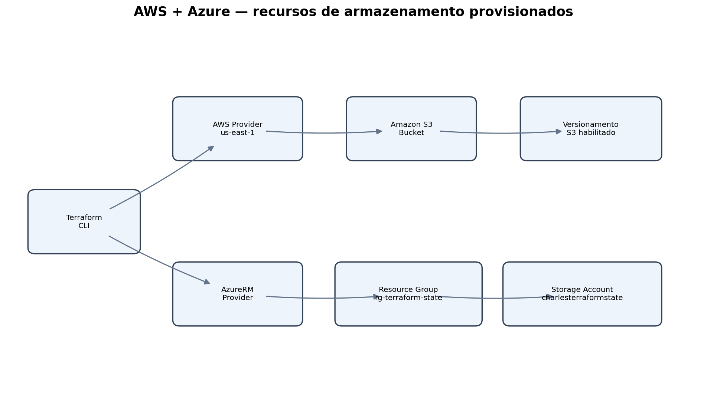

# AWS + Azure — armazenamento para State

## Objetivo
Laboratório de provisionamento de recursos de armazenamento em duas nuvens usando os providers AWS e AzureRM.

## Recursos definidos
- AWS: bucket S3 `charlessilva-remote-state`, com versionamento habilitado, na região `us-east-1`.
- Azure: Resource Group `rg-terraform-state`, Storage Account `charlesterraformstate` e container privado `remote-state`.
- Tags comuns: `owner=charlessilva` e `managed-by=terraform`.

## Arquitetura


Fonte editável: [`docs/architecture.mmd`](./docs/architecture.mmd).

## Observação importante
Apesar do nome do diretório, o código atual **não configura um backend remoto** (`backend` block). Ele provisiona os recursos S3 e Azure Storage que poderiam ser usados em estratégias de armazenamento de state. O state deste projeto permanece no backend padrão local.

## Executar
```bash
terraform init
terraform validate
terraform plan
terraform apply
```

Configure previamente as credenciais AWS e Azure. Revise custos, nomes globais e permissões antes de aplicar.
