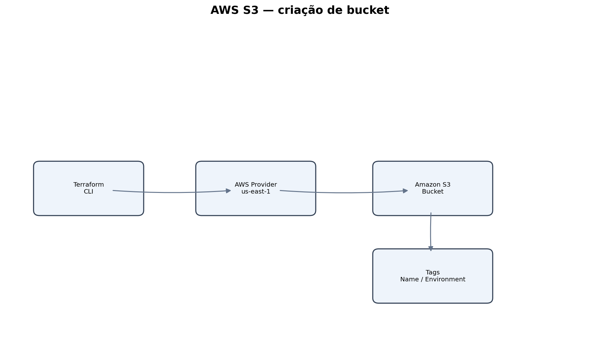

# AWS S3 Bucket

## Objetivo
Criar um bucket Amazon S3 usando Terraform, na região `us-east-1`.

## Recursos definidos
- `aws_s3_bucket.bucket`
- Bucket: `charlessilva-terraform-bucket`
- Tags: `Name=Terraform bucket` e `Environment=Dev`.

## Arquitetura


Fonte editável: [`docs/architecture.mmd`](./docs/architecture.mmd).

## Executar
```bash
terraform init
terraform validate
terraform plan
terraform apply
```

O nome de bucket S3 precisa ser globalmente único. O state usa o backend local padrão, pois não há bloco `backend` nesta configuração.
