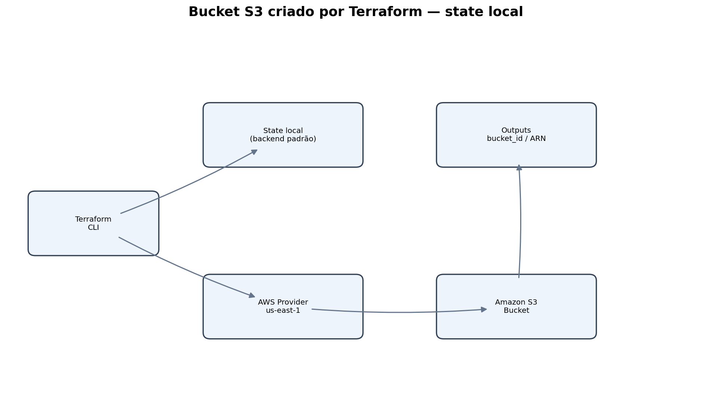

# AWS S3 — bucket com Terraform State local

## Objetivo
Provisionar um bucket S3 e expor seu ID e ARN como outputs.

## Recursos definidos
- Bucket: `charlessilva-terraform-local-state`
- Região: `us-east-1`
- Outputs: `bucket_id` e `bucket_arn`.

## Arquitetura


Fonte editável: [`docs/architecture.mmd`](./docs/architecture.mmd).

## Atenção ao nome do laboratório
O código atual **não configura o S3 como backend do Terraform**. Como não existe bloco `backend "s3"`, o arquivo de state do próprio laboratório permanece local. O bucket criado é apenas um recurso gerenciado pela configuração.

## Executar
```bash
terraform init
terraform validate
terraform plan
terraform apply
```
