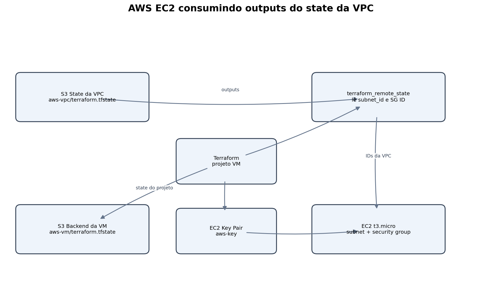

# AWS EC2 — consumo de Terraform Remote State

## Objetivo
Criar uma instância EC2 reutilizando os outputs de uma infraestrutura VPC provisionada em outro diretório Terraform.

## Fluxo implementado
1. O backend S3 deste projeto armazena o state em `aws-vm/terraform.tfstate`.
2. O data source `terraform_remote_state.vpc` lê `aws-vpc/terraform.tfstate` no bucket `charlessilva-remote-state`.
3. Os outputs `subnet_id` e `security_group_id` são usados na instância EC2.
4. Uma Key Pair chamada `aws-key` é registrada na AWS.

## Recursos definidos
- EC2 `t3.micro`.
- AMI `ami-0b6c6ebed2801a5cb`.
- Key Pair `aws-key`.
- Associação à subnet e ao Security Group lidos do state da VPC.

## Arquitetura


Fonte editável: [`docs/architecture.mmd`](./docs/architecture.mmd).

## Pré-requisito
Aplique primeiro o laboratório [`AWS-VPC`](../AWS-VPC/README.md) e confirme que os outputs `subnet_id` e `security_group_id` existem.

O arquivo `aws-key.pub` é referenciado por `vm.tf`, mas não veio no ZIP enviado. Disponibilize a chave pública no diretório antes de executar.

## Executar
```bash
terraform init
terraform validate
terraform plan
terraform apply
```
