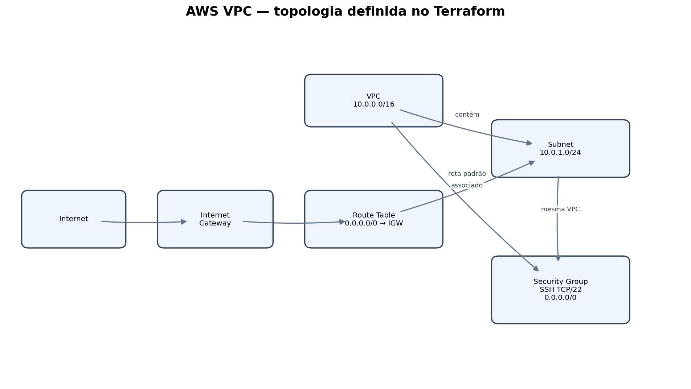

# AWS VPC — rede virtual

## Objetivo
Provisionar uma VPC, subnet, conectividade com Internet Gateway, tabela de rotas e Security Group.

## Recursos definidos
| Recurso | Configuração |
|---|---|
| VPC | `10.0.0.0/16` |
| Subnet | `10.0.1.0/24` |
| Internet Gateway | Associado à VPC |
| Route Table | Rota `0.0.0.0/0` pelo Internet Gateway |
| Security Group | Entrada TCP/22 de `0.0.0.0/0`; saída liberada |
| Backend | S3: `aws-vpc/terraform.tfstate`, bucket `charlessilva-remote-state`, `us-east-1` |

## Arquitetura


Fonte editável: [`docs/architecture.mmd`](./docs/architecture.mmd).

## Outputs
- `subnet_id`
- `security_group_id`

## Atenção de segurança
A regra SSH atual permite acesso de qualquer endereço IPv4 (`0.0.0.0/0`). Para uso real, restrinja `cidr_blocks` ao IP ou à faixa administrativa necessária. O diagrama representa o código atual, não uma recomendação de exposição pública.

## Executar
```bash
terraform init
terraform validate
terraform plan
terraform apply
```
