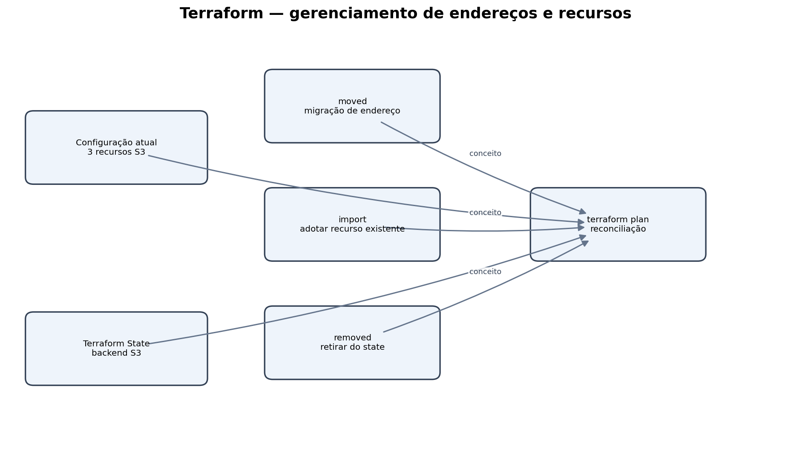

# Terraform — moved, removed e import

## Objetivo
Laboratório voltado ao estudo de mudanças no endereço dos recursos e da adoção/remoção de recursos no gerenciamento do Terraform.

## O que existe atualmente no código
- Provider AWS na região `sa-east-1`.
- Backend S3: bucket `charlessilva-remote-state`, chave `moved-removed-import/terraform.tfstate`.
- Três recursos `aws_s3_bucket`: `bucket_1`, `bucket_2` e `bucket_3`.

**Nota de precisão:** no ZIP analisado, não há blocos `moved`, `removed` ou `import` declarados. O diagrama apresenta o fluxo conceitual do laboratório e sinaliza essa diferença.

## Arquitetura / fluxo de estudo


Fonte editável: [`docs/architecture.mmd`](./docs/architecture.mmd).

## Comandos úteis
```bash
terraform init
terraform plan
terraform state list
terraform state show aws_s3_bucket.bucket_1
```

Consulte a documentação oficial para os blocos [`moved`](https://developer.hashicorp.com/terraform/language/moved), [`removed`](https://developer.hashicorp.com/terraform/language/resources/syntax#removing-resources) e [`import`](https://developer.hashicorp.com/terraform/language/import).
