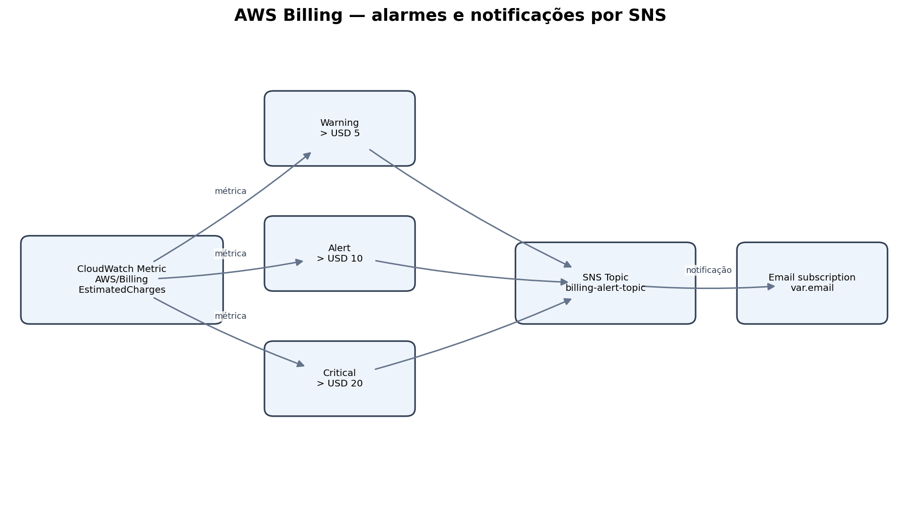

# AWS Billing — múltiplos alertas de custo

## Objetivo
Criar alarmes CloudWatch para custos estimados da AWS e encaminhar notificações por e-mail usando Amazon SNS.

## Recursos definidos
- Provider AWS com alias `billing`, região `sa-east-1`.
- SNS Topic: `billing-alert-topic`.
- Assinatura SNS via e-mail (`var.email`).
- Três alarmes para a métrica `AWS/Billing` / `EstimatedCharges`:
  - Warning: acima de USD 5.
  - Alert: acima de USD 10.
  - Critical: acima de USD 20.
- Backend S3: `charlessilva-remote-state`, chave `aws-cloudwatch/terraform.tfstate`.

## Arquitetura


Fonte editável: [`docs/architecture.mmd`](./docs/architecture.mmd).

## Variável obrigatória
Crie um arquivo `terraform.tfvars` local (não o versione) ou informe a variável:
```hcl
email = "seu-email@exemplo.com"
```
A assinatura de e-mail do SNS precisa ser confirmada pelo destinatário.

## Executar
```bash
terraform init
terraform validate
terraform plan
terraform apply
```

## Observação
A disponibilidade e a configuração da métrica de faturamento devem ser verificadas na conta AWS. Alarmes de custo são mecanismos de notificação, não limites que bloqueiam gastos.
