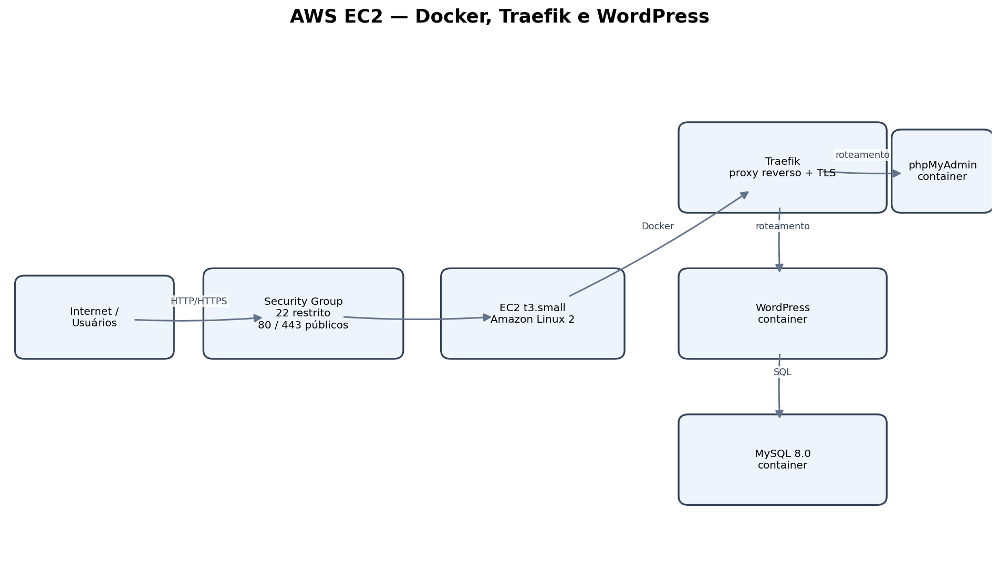

# AWS EC2 — WordPress com Docker e Traefik

## Objetivo
Provisionar uma instância EC2 e inicializar Docker, Docker Compose e Traefik via `user_data`, com serviços WordPress, MySQL e phpMyAdmin definidos no Compose.

## Infraestrutura AWS
- Região padrão: `sa-east-1`.
- Instância: `t3.small`.
- AMI definida em variável (`ami-06a73f9d93a3879b5`, descrita como Amazon Linux 2).
- Security Group:
  - SSH TCP/22 permitido a partir de `189.124.16.0/20`.
  - HTTP TCP/80 e HTTPS TCP/443 públicos.
  - Saída liberada.
- Key Pair: `aws-key`.
- Backend S3: `charlessilva-remote-state`, chave `aws-wordpress/terraform.tfstate`.

## Serviços Docker definidos
- Traefik: proxy reverso, TLS/ACME e dashboard.
- WordPress: porta interna 80, volume persistente `wordpress`.
- MySQL 8.0: volume persistente `db`.
- phpMyAdmin: interface administrativa.
- Rede externa Docker `traefik`.

## Arquitetura


Fonte editável: [`docs/architecture.mmd`](./docs/architecture.mmd).

## Executar
```bash
terraform init
terraform validate
terraform plan
terraform apply
```

## Pontos que precisam de revisão antes de produção
1. O `docker-compose.yml` contém credenciais literais (`senhaaqui`). Use secrets ou variáveis protegidas e troque qualquer senha real que tenha sido publicada.
2. O Compose declara a rede `traefik` como externa. O `user_data` precisa criar essa rede antes de executar `docker-compose up -d`; no script atual não encontrei esse comando.
3. O Terraform referencia `aws-key.pub`, mas esse arquivo não está incluído no ZIP enviado.
4. O script cria arquivos de configuração e serviços com versões `latest`; considere fixar versões para tornar os deploys reproduzíveis.
5. O Security Group publica 80/443 para a Internet, conforme esperado para web, mas mantenha o acesso administrativo restrito.
6. O Compose publica portas 8083 e 8084 no host; avalie se precisam mesmo ficar acessíveis diretamente, já que o proxy reverso também está configurado.

## Backup e restauração
O README anterior continha comandos para backup e restauração dos volumes Docker. Preservei esse tema na documentação do laboratório; valide nomes reais dos volumes e containers antes de executar os comandos de backup/restauração.
